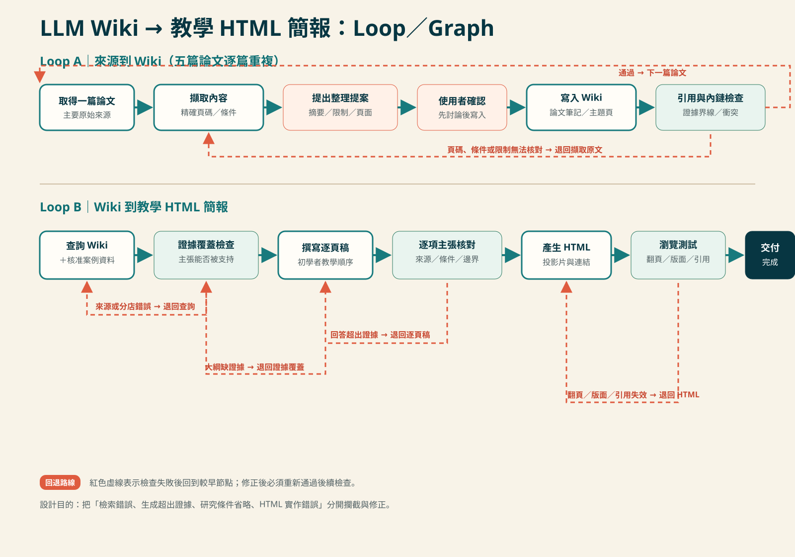

# 從餐廳訂位看懂 RAG

這是一個面向 AI 初學者的 LLM Wiki 與教學型 HTML 簡報。專案以餐廳客服回答訂位規則、營業時間及即時空位為貫穿案例，說明 RAG 的檢索、生成、評估與證據邊界。

## 公開成果

- [LLM Wiki 入口](wiki/index.md)
- [教學 HTML 簡報](https://s411283037.github.io/LLM_WIKI/output/slides/)
- [Loop／Graph 流程圖](loop-graph.png)
- [逐題繳交內容](繳交內容.txt)
- [實際檢查與故障注入紀錄](wiki/故障注入測試.md)

## 五篇主要來源

1. Retrieval-Augmented Generation for Knowledge-Intensive NLP Tasks
2. Dense Passage Retrieval for Open-Domain Question Answering
3. Lost in the Middle: How Language Models Use Long Contexts
4. Ragas: Automated Evaluation of Retrieval Augmented Generation
5. SELF-RAG: Learning to Retrieve, Generate, and Critique through Self-Reflection

每篇論文的結構化筆記位於 [`wiki/papers/`](wiki/papers/)，原始 PDF 位於 [`raw/papers/`](raw/papers/)。案例資料是自編教學示例，不計入五篇主要來源。

## 專案流程

專案使用兩個相連的 loop：

- Loop A：取得論文 → 擷取原文與頁碼 → 提案 → 使用者確認 → 寫入 Wiki → 引用與內鏈檢查。
- Loop B：查詢 Wiki → 證據覆蓋檢查 → 逐頁稿 → 主張核對 → HTML → 瀏覽測試 → 交付。

## 簡報操作

簡報共 13 頁，支援畫面按鈕、鍵盤左右鍵、Home 與 End 鍵翻頁。研究主張連回隨附論文及精確頁碼，案例事實連回自編資料 ID。

